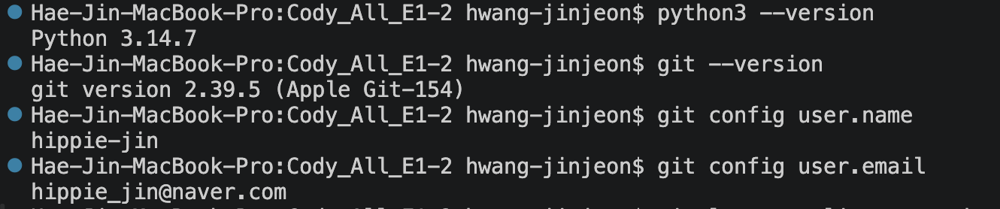
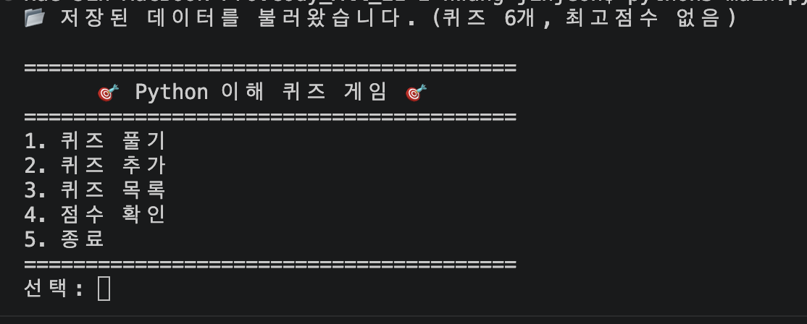
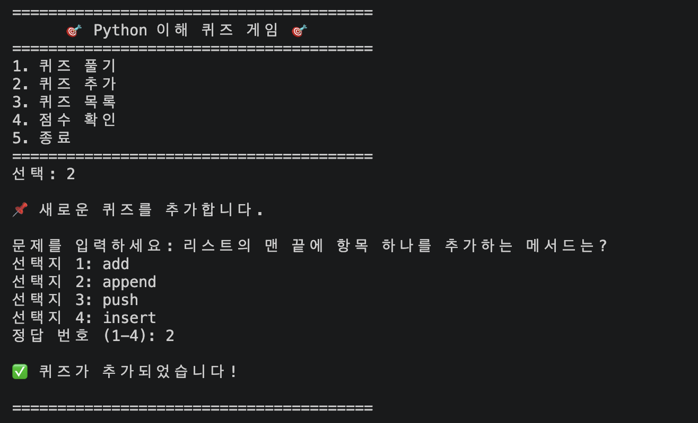
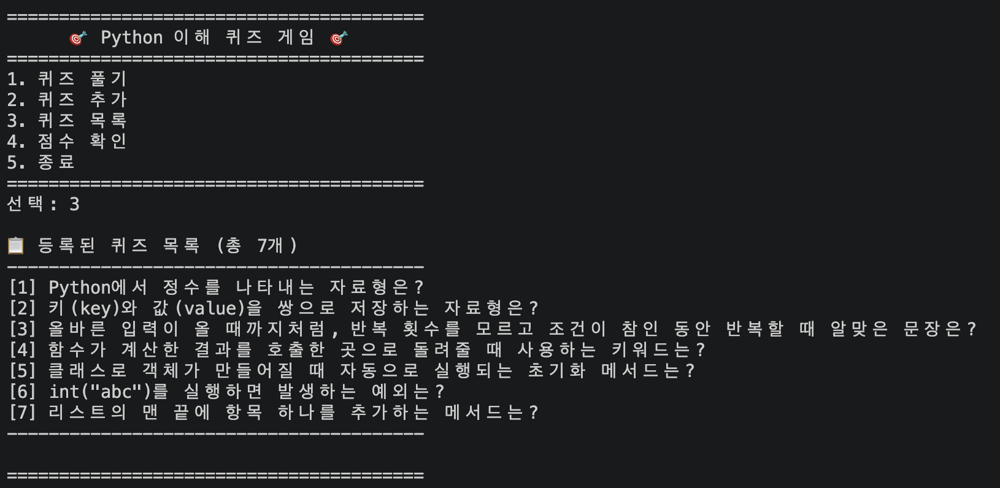
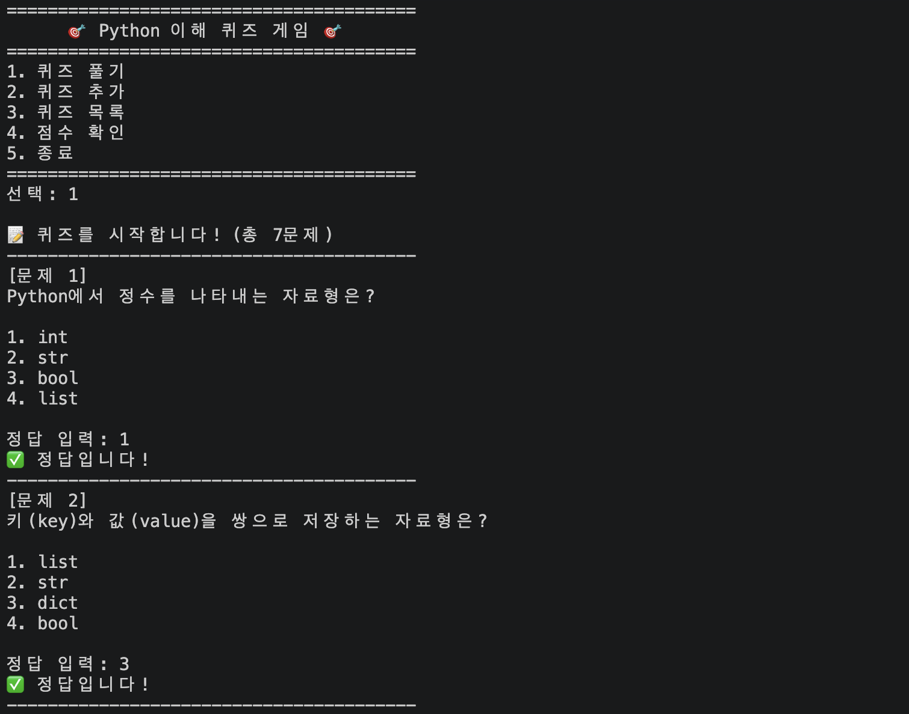
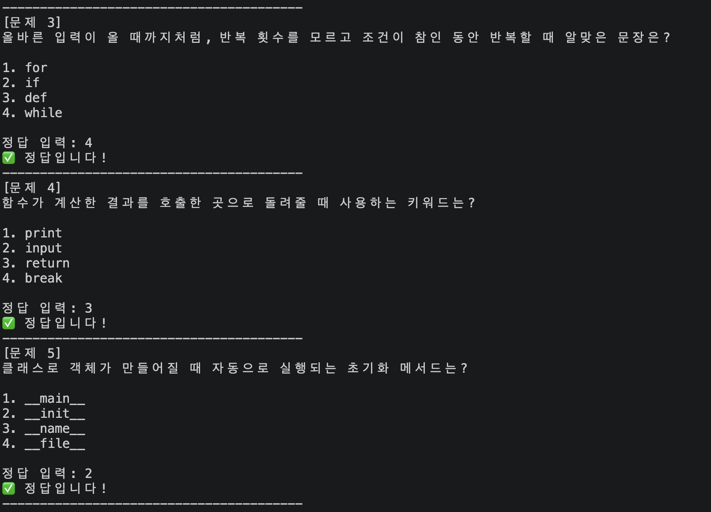
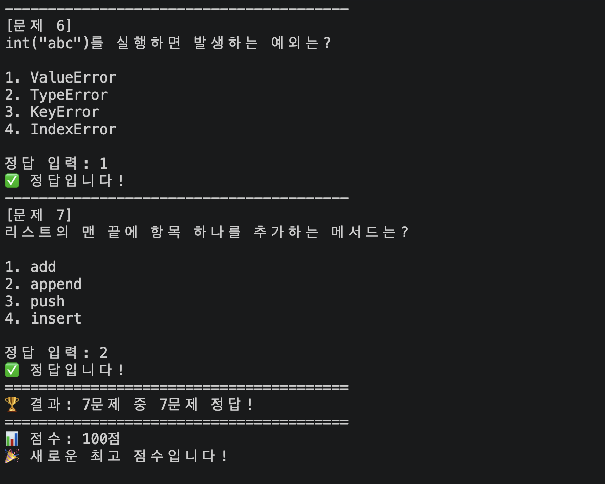
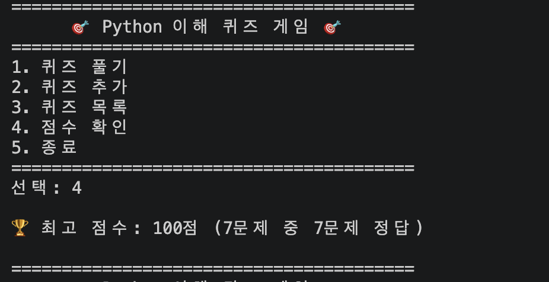
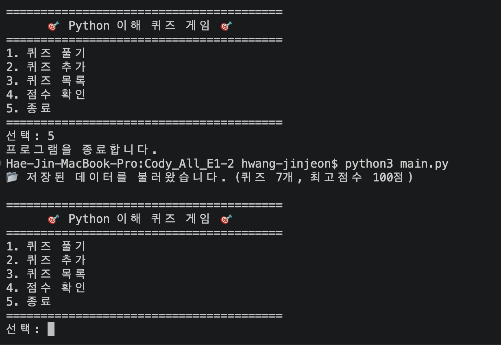
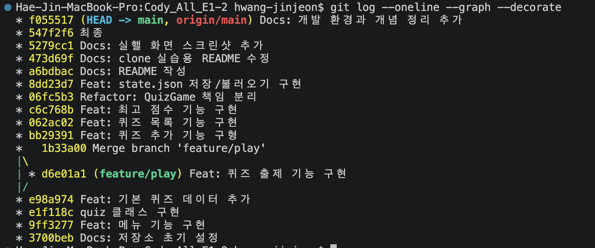

# Python 이해 퀴즈 게임

## 프로젝트 개요

터미널에서 동작하는 퀴즈 게임입니다. 메뉴에서 번호를 선택해 퀴즈 풀기, 퀴즈 추가, 퀴즈 목록 보기, 최고 점수 확인, 종료를 할 수 있습니다.

Python 기본 문법(변수, 자료형, 조건문, 반복문, 함수)과 클래스(`Quiz`, `QuizGame`)로 코드를 역할별로 나누어 구현합니다. 퀴즈와 최고 점수는 `state.json` 파일에 UTF-8로 저장하므로 프로그램을 종료하고 다시 실행해도 유지됩니다. 개발 과정은 Git으로 기능 단위로 커밋하고, 브랜치를 나눠 작업한 뒤 병합하며, GitHub에 공개합니다.

## 퀴즈 주제와 선정 이유

주제는 **Python의 이해**입니다.

이 프로젝트의 목적이 Python을 배우는 것이라, 퀴즈 주제도 Python으로 정했습니다. 기본 퀴즈 6개는 프로젝트를 만들면서 직접 다룬 개념(자료형, 반복문, 함수, 클래스, 예외 처리)에서 냈기 때문에, 게임을 만들고 푸는 과정이 그대로 Python 복습이 됩니다.

## 실행 방법

1. Python 3.10 이상이 필요합니다. 외부 라이브러리는 사용하지 않으므로 별도 설치는 없습니다.

   ```bash
   python3 --version
   ```

2. 저장소를 받고 폴더로 이동합니다.

   ```bash
   git clone https://github.com/hippie-jin/codyssey_all_E1-2.git
   cd codyssey_all_E1-2
   ```

3. 프로그램을 실행합니다.

   ```bash
   python3 main.py
   ```

`state.json`은 실행하는 위치와 상관없이 프로젝트 폴더에 저장되고 불러와집니다.

## 개발 환경

| 항목 | 내용 |
|---|---|
| 운영체제 | macOS |
| Python | 3.14.7 (과제 조건: 3.10 이상) |
| Git | 2.39.5 (Apple Git-154) |
| Git 사용자 이름 | hippie-jin |
| 외부 라이브러리 | 없음 (표준 라이브러리 `json`, `os`, `pathlib`만 사용) |



## 기능 목록

| 메뉴 | 기능 |
|---|---|
| 1. 퀴즈 풀기 | 저장된 퀴즈를 순서대로 출제하고, 정답과 오답을 알려 주며, 끝나면 결과와 점수를 보여 줍니다. 퀴즈가 없으면 안내합니다. |
| 2. 퀴즈 추가 | 문제, 선택지 4개, 정답 번호(1~4)를 입력받아 퀴즈를 추가하고 바로 저장합니다. |
| 3. 퀴즈 목록 | 등록된 퀴즈의 문제를 번호와 함께 보여 줍니다. 퀴즈가 없으면 안내합니다. |
| 4. 점수 확인 | 최고 점수를 보여 줍니다. 아직 풀지 않았으면 안내합니다. |
| 5. 종료 | 저장 후 프로그램을 종료합니다. |

공통 기능은 다음과 같습니다.

- **점수 계산:** `정답 수 × 100 ÷ 문제 수`의 몫(100점 만점 환산)입니다. 문제 수가 달라져도 점수를 비교할 수 있고, 최고 점수보다 높을 때만 갱신합니다.
- **입력 검증:** 앞뒤 공백을 제거하고, 빈 입력, 숫자 변환 실패, 허용 범위 밖 숫자는 안내 후 다시 입력받습니다.
- **안전한 종료:** Ctrl+C나 입력 스트림 종료(EOF)가 발생해도 오류 없이 저장 후 종료합니다.
- **자동 저장:** 퀴즈를 추가하거나 최고 점수가 갱신될 때, 종료할 때 `state.json`에 저장합니다.
- **복구:** `state.json`이 없으면 기본 퀴즈로 시작하고, 손상되었거나 형식이 올바르지 않으면 안내 후 기본 퀴즈로 복구합니다.

## 실행 화면

### 메뉴



### 퀴즈 추가



### 퀴즈 목록



### 퀴즈 풀기







### 점수 확인



### 재시작 후 데이터 유지

프로그램을 종료하고 다시 실행해도 추가한 퀴즈와 최고 점수가 유지됩니다.



## 파일 구조

```
.
├── main.py              # 프로그램 시작점 (QuizGame 실행)
├── quiz_game.py         # QuizGame 클래스: 메뉴, 게임 진행, state.json 저장/불러오기
├── quiz.py              # Quiz 클래스: 퀴즈 한 개 (출력, 정답 확인, dict 변환)
├── default_quizzes.py   # 기본 퀴즈 데이터 (Quiz 객체 6개)
├── input_utils.py       # 입력 처리 함수 (read_int, read_text)
├── state.json           # 퀴즈와 최고 점수 저장 파일
├── docs/screenshots/    # 실행 화면과 개발 환경 스크린샷
├── .gitignore
└── README.md
```

## 데이터 파일 설명 (state.json)

- **경로:** 프로젝트 루트의 `state.json` (UTF-8)
- **역할:** 퀴즈 목록과 최고 점수를 저장합니다. 저장소에는 기본 퀴즈가 든 초기 상태로 포함되어 있고, 프로그램을 실행하면 갱신됩니다.
- **저장 시점:** 퀴즈 추가, 최고 점수 갱신, 프로그램 종료 시
- **저장 방식:** 임시 파일(`state.json.tmp`)에 먼저 쓴 뒤 교체하므로 저장 도중 중단되어도 기존 파일이 손상되지 않습니다.

### 스키마

```json
{
    "quizzes": [
        {
            "question": "Python에서 정수를 나타내는 자료형은?",
            "choices": ["int", "str", "bool", "list"],
            "answer": 1
        }
    ],
    "best_score": {
        "score": 83,
        "correct": 5,
        "total": 6
    }
}
```

| 필드 | 타입 | 설명 |
|---|---|---|
| `quizzes` | 리스트 | 퀴즈 목록 |
| `quizzes[].question` | 문자열 | 문제 (비어 있으면 안 됨) |
| `quizzes[].choices` | 문자열 4개의 리스트 | 선택지 |
| `quizzes[].answer` | 정수 1~4 | 정답 번호 (선택지 순서 기준) |
| `best_score` | 객체 또는 `null` | 최고 기록. 아직 풀지 않았으면 `null` |
| `best_score.score` | 정수 | 100점 만점 환산 점수 |
| `best_score.correct` | 정수 | 그때의 정답 수 |
| `best_score.total` | 정수 | 그때의 문제 수 |

### 파일이 없거나 손상된 경우

| 상황 | 동작 |
|---|---|
| 파일이 없음(첫 실행) | 기본 퀴즈로 시작하고, 첫 저장 때 파일을 만듭니다. |
| JSON 형식이 아니거나 인코딩이 깨짐 | 안내 후 기본 퀴즈로 복구합니다. |
| JSON은 맞지만 구조·값이 올바르지 않음(예: `answer`가 9) | 안내 후 기본 퀴즈로 복구합니다. |
| 읽기·쓰기 권한 오류 | 안내 후 계속 실행합니다. |

> clone/pull 실습: 복제본에서 추가한 한 줄입니다.

## Git 이력

`git log --oneline --graph --decorate` 결과입니다. 구현을 마친 시점(`f055517`)까지의 이력이며, 이 이력을 README에 추가하는 마지막 커밋은 포함되어 있지 않습니다.



```
* f055517 (HEAD -> main, origin/main) Docs: 개발 환경과 개념 정리 추가
* 547f2f6 최종
* 5279cc1 Docs: 실핼 화면 스크린샷 추가
* 473d69f Docs: clone 실습용 README 수정
* a6bdbac Docs: README 작성
* 8dd23d7 Feat: state.json 저장/불러오기 구현
* 06fc5b3 Refactor: QuizGame 책임 분리
* c6c768b Feat: 최고 점수 기능 구현
* 062ac02 Feat: 퀴즈 목록 기능 구현
* bb29391 Feat: 퀴즈 추가 기능 구형
*   1b33a00 Merge branch 'feature/play'
|\  
| * d6e01a1 (feature/play) Feat: 퀴즈 출제 기능 구현
|/  
* e98a974 Feat: 기본 퀴즈 데이터 추가
* e1f118c quiz 클래스 구현
* 9ff3277 Feat: 메뉴 기능 구현
* 3700beb Docs: 저장소 초기 설정
```

- 커밋 16개, 브랜치 `feature/play`를 만들어 작업한 뒤 `main`에 병합(merge 커밋 `1b33a00`)했습니다.
- clone·pull 실습은 별도 폴더에서 README를 수정해 push(`473d69f`)한 뒤 원본에서 pull해 반영했습니다.

## 개념 정리

구현하면서 사용한 개념을 정리했습니다. 각 개념이 이 프로젝트의 어느 코드에서 쓰였는지 함께 적었습니다.

### Python 기초

| 개념 | 설명 | 이 프로젝트에서 |
|---|---|---|
| 변수 | 값에 이름을 붙여 저장하는 공간. 같은 값을 반복해서 쓰고 나중에 바꾸기 쉽게 한다. | `correct = 0`(정답 수), `self.best_score` |
| `int`, `str`, `bool` | 정수, 문자열, 참/거짓 | 정답 번호(`int`), 문제 문장(`str`), 정답 여부(`bool`) |
| `list` | 순서가 있고 수정할 수 있는 값의 묶음. 인덱스는 0부터 시작한다. | 퀴즈 목록 `self.quizzes`, 선택지 `choices` |
| `dict` | 키로 값을 찾는 묶음 | 최고 기록 `{"score": 83, "correct": 5, "total": 6}` |
| `if / elif / else` | 조건에 따라 실행할 코드를 나눈다. | 메뉴 번호에 따라 기능 호출(`run`) |
| `for` | 횟수나 항목이 정해진 반복 | 퀴즈를 하나씩 출제(`for number, quiz in enumerate(...)`) |
| `while` | 조건이 참인 동안 반복. 횟수를 모를 때 쓴다. | 올바른 입력이 올 때까지 다시 묻기(`read_int`), 메뉴 루프 |
| `break`, `continue` | 반복문을 끝낸다 / 남은 부분을 건너뛰고 처음으로 돌아간다. | 종료 선택 시 `break`, 잘못된 입력 시 `continue` |
| 함수 | 이름을 붙인 재사용 가능한 코드 묶음. 매개변수는 입력, 반환값(`return`)은 결과다. | `read_int(prompt, low, high)`는 정수를 반환 |
| `enumerate(..., start=1)` | 항목과 번호를 함께 돌려준다. | 문제·선택지 번호를 1부터 출력 |
| `/`, `//`, `%` | 실수 나눗셈, 몫, 나머지 | 점수 `정답 수 * 100 // 문제 수`(`5 * 100 // 6`은 83) |
| `None` | "값이 없음". 비교는 `is None`으로 한다. | 아직 푼 적이 없으면 `best_score`가 `None` |
| 단락 평가 | `or`는 앞이 참이면 뒤를 계산하지 않는다. 순서가 안전장치가 된다. | `best is None or record["score"] > best["score"]`. 순서를 바꾸면 처음 플레이 때 `TypeError`가 난다. |
| `strip()` | 문자열 앞뒤 공백을 제거한다. | 입력 검증의 첫 단계 |
| `if __name__ == "__main__":` | 이 파일을 직접 실행할 때만 아래 코드가 돈다. `import`해도 자동 실행되지 않는다. | `main.py` |

### 클래스와 객체

| 개념 | 설명 | 이 프로젝트에서 |
|---|---|---|
| 클래스 | 객체를 만드는 설계도. 관련된 데이터(속성)와 기능(메서드)을 한곳에 묶는다. | `Quiz`, `QuizGame` |
| 객체(인스턴스) | 클래스로 만든 실제 대상. 객체마다 자기 데이터를 따로 가진다. | `Quiz("질문", [...], 2)` |
| `__init__` | 객체가 만들어질 때 자동 실행되는 초기화 메서드 | `Quiz`의 속성 설정, `QuizGame`의 `self.quizzes = []` |
| `self` | 메서드 안에서 "이 객체 자신"을 가리키는 첫 번째 매개변수 | `self.question`, `self.best_score` |
| 속성 / 메서드 | 객체가 가진 데이터 / 객체가 할 수 있는 동작 | `quiz.answer` / `quiz.is_correct(n)` |
| `@classmethod` | 객체 없이 클래스에서 바로 부르는 메서드 | `Quiz.from_dict(data)` |
| 책임 분리 | 클래스마다 맡은 일을 나눈다. | `Quiz`는 퀴즈 한 개, `QuizGame`은 게임 전체 |
| 상태가 없는 기능은 함수로 | 객체의 데이터를 쓰지 않는 기능은 클래스에 넣지 않는다. | `input_utils.py`의 `read_int`, `read_text` |
| 리팩터링 | 동작은 그대로 두고 구조만 정리한다. | 함수 → `QuizGame` 클래스로 정리 (`Refactor:` 커밋) |
| 같은 리스트를 가리킴 | 함수 안에서 리스트를 수정하면 호출한 쪽의 리스트도 바뀐다. | `self.quizzes.append(...)` |

### 파일 입출력과 예외 처리

| 개념 | 설명 | 이 프로젝트에서 |
|---|---|---|
| 파일 입출력 과정 | 열기(`open`) → 읽기·쓰기 → 닫기. `with open(...) as f:`는 블록이 끝나면 자동으로 닫는다. | `load_state`, `save_state` |
| JSON | 텍스트 기반의 데이터 형식. dict·list와 구조가 비슷하고 언어와 무관하게 읽을 수 있다. | `state.json` |
| `json.dump` / `json.load` | Python 객체를 파일에 쓴다 / 파일에서 읽어 Python 객체로 돌려준다. | 퀴즈와 최고 점수 저장·불러오기 |
| 객체 ↔ dict 변환 | JSON은 객체를 직접 저장할 수 없어서 dict로 바꾼다. | `to_dict()`로 저장, `from_dict()`로 복원 |
| UTF-8, `ensure_ascii=False` | 한글을 표현하는 인코딩. `ensure_ascii=False`가 없으면 한글이 `\uXXXX`로 저장된다. | `open(..., encoding="utf-8")` |
| 데이터 영속성 | 프로그램을 꺼도 데이터가 남는 성질 | 종료 후 재실행해도 퀴즈와 최고 점수 유지 |
| `try / except` | 오류가 날 수 있는 코드를 `try`에 두고, 오류가 나면 `except`에서 처리해 프로그램이 죽지 않게 한다. | 입력 오류, 파일 오류 처리 |
| `ValueError` | 값의 형태가 맞지 않을 때 발생. `int("abc")`가 대표적이다. | 숫자 변환 실패(`read_int`) |
| `FileNotFoundError` | 파일이 없을 때 발생. `OSError`의 하위 예외라서 `OSError`보다 **먼저** 써야 한다. `except`는 위에서부터 차례로 검사한다. | 첫 실행 시 기본 퀴즈로 시작 |
| `json.JSONDecodeError` | 파일이 올바른 JSON이 아닐 때 발생 | 손상된 `state.json`을 기본 퀴즈로 복구 |
| `KeyboardInterrupt`, `EOFError` | Ctrl+C, 입력 스트림 종료 | 프로그램 전체를 감싸 안내 후 저장하고 종료 |
| 예외 처리 범위 | 입력 한 건의 오류는 그 자리에서, 프로그램 전체를 중단시키는 오류는 바깥에서 처리한다. | `ValueError`는 `read_int`, `KeyboardInterrupt`는 `run()` |
| 입력 검증 순서 | 빈 입력 → 숫자 변환 → 범위 확인 순서로 검사한다. `int("")`도 `ValueError`이므로, 빈 입력을 먼저 걸러야 별도 안내를 할 수 있다. | `read_int` |
| 데이터 검증 | 파일이 JSON으로는 맞아도 값이 틀릴 수 있다(예: `answer`가 9). 불러올 때 구조와 값을 확인한다. | `is_valid_quiz_data`, `is_valid_best_score` |
| 임시 파일 후 교체 | 임시 파일에 먼저 쓰고 `os.replace`로 바꾸면 저장 도중 꺼져도 기존 파일이 손상되지 않는다. | `save_state` |
| 경로 | `Path(__file__).resolve().parent`로 이 파일이 있는 폴더를 기준으로 잡으면 어디서 실행해도 같은 위치다. | `STATE_FILE` |

### Git

| 개념 | 설명 | 이 프로젝트에서 |
|---|---|---|
| Git | 파일의 변경 이력을 기록하고 되돌릴 수 있게 하는 버전 관리 도구 | 기능 단위로 커밋 |
| GitHub | Git 저장소를 인터넷에 올려 보관·공유하는 서비스 (Git과는 별개) | 원격 저장소 `origin` |
| 저장소(repository) | 프로젝트 파일과 변경 이력을 담은 공간. 로컬과 원격이 있다. | |
| `git init` | 현재 폴더를 새 Git 저장소로 만든다. | 저장소 초기 설정 |
| `git add` | 변경 파일을 커밋 대기 영역(staging area)에 올린다. 관련된 변경만 골라 한 커밋으로 묶을 수 있다. | |
| `git commit` | staging 영역의 변경을 하나의 이력으로 기록한다. 로컬에만 저장된다. | `Feat: …`, `Fix: …`, `Docs: …`, `Refactor: …` |
| `git push` | 로컬 커밋을 원격 저장소로 올린다. `-u`는 이후 `git push`만으로 연결되게 한다. | |
| `git pull` | 원격의 변경을 가져와 합친다(`fetch` + `merge`). | clone 실습 |
| `git clone` | 원격 저장소 전체를 새 폴더로 복제한다. `origin`이 자동으로 설정된다. | `Cody_All_E1-2_clone` |
| `git checkout` | 브랜치를 전환한다. `-b`를 붙이면 만들면서 전환한다. | `git checkout -b feature/play` |
| 브랜치(branch) | 이력의 갈래. `main`을 건드리지 않고 기능을 따로 개발한다. | `feature/play` |
| `git merge` | 다른 브랜치의 변경을 현재 브랜치에 합친다. 합쳐질 쪽(`main`)에 가서 실행한다. | `git merge feature/play --no-ff` |
| fast-forward | 새 커밋 없이 브랜치 포인터만 앞으로 옮기는 합치기. `--no-ff`는 merge 커밋을 만들어 갈래의 흔적을 남긴다. | `pull`은 fast-forward, 브랜치 합치기는 `--no-ff` |
| `.gitignore` | Git이 추적하지 않을 파일을 지정한다. | `__pycache__/`, `.DS_Store`, `state.json.tmp` |
| `git status` / `git diff` | 변경 상태를 본다 / add하지 않은 변경 내용을 본다. | 매 단계 확인 |
| `git log --oneline --graph` | 커밋 이력을 한 줄씩, 갈래를 그림으로 보여 준다. | 제출용 이력 확인 |
| 커밋 메시지 | 변경 내용을 드러내는 형식(`Feat:`, `Fix:`, `Docs:`, `Refactor:`)으로 쓴다. | |
